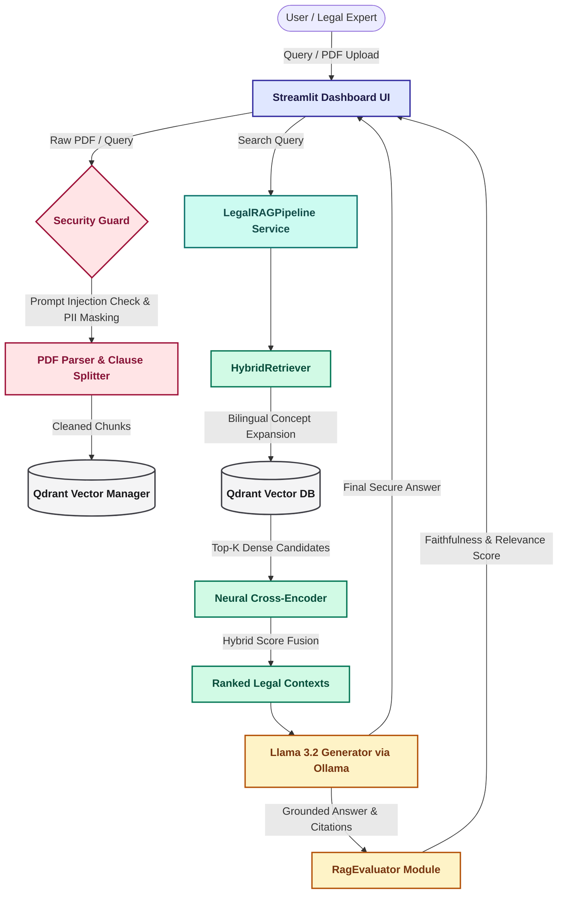

# 🏛️ Enterprise Legal RAG Agent — Comprehensive System Architecture

This document illustrates the end-to-end architecture of the Enterprise Legal RAG Agent, highlighting data flow, security guardrails, hybrid retrieval mechanics, and evaluation loops.

---

## 📊 End-to-End System Architecture Diagram

